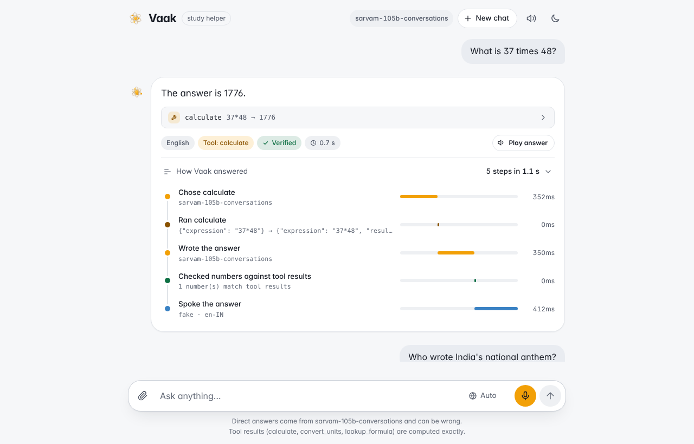
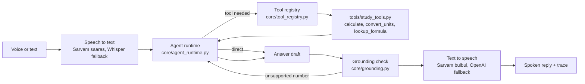

# Vaak

**Live demo:** [vaak.onrender.com](https://vaak.onrender.com) (first load may take ~30 s)

[](https://github.com/indhuja-elumalai/vaak/actions/workflows/ci.yml)

**A voice study helper that knows when to calculate and when to just answer, in English, Hindi, Tamil and code-mixed speech.**

Ask a question out loud. Vaak decides per question whether it needs a real tool (calculate,
convert units, look up a formula) or a direct answer, checks every number in its reply
against the tool results, and speaks the answer back in the language you used.



## Why

Most voice-AI demos are a thin speech → LLM → speech wrapper: every answer is generated
text, nothing is verified, and quality is asserted rather than measured. Vaak treats two
things as engineering problems with numbers attached:

1. **Routing:** knowing when a question needs a deterministic tool and when a direct
   language-model answer is right.
2. **Grounding:** proving the numbers in a spoken answer came from a tool, and rewriting the
   answer when they didn't.

## Evaluation results

Measured on a 40-case set (47 turns, including 7 follow-up conversations) in five languages,
with the default model `sarvam-105b-conversations`. Full reports, including every miss:
[text](eval/results/2026-10-31-text.md) and [voice](eval/results/2026-10-31-voice.md).

| Mode | Turns | Routing accuracy | Task completion | Grounded tool answers | Latency p50 | Latency p95 |
|---|---:|---:|---:|---:|---:|---:|
| Text | 47 | 97.9% | 97.9% | 100% | 0.48 s | 0.92 s |
| Voice (speech → agent → speech) | 47 | 97.9% | 91.5% | 100%* | 2.55 s | 4.71 s |

Task completion by language:

| | English | Hindi | Hinglish | Tamil | Tanglish |
|---|---:|---:|---:|---:|---:|
| Text | 100% | 88.9% | 100% | 100% | 100% |
| Voice | 100% | 77.8% | 100% | 88.9% | 87.5% |

- **Routing** = the right tool was called, or none for questions that need no tool.
  **Task completion** = the final answer contains the expected value or phrase.
  **Grounded** = tool answers whose numbers all match tool results. No API errors in either run.
- **Text misses:** one Hinglish turn answered "12 ka square" from memory instead of calling
  the tool (correct answer, wrong route), and one correct Hindi formula spelled in words was not
  matched by the scorer.
- **Voice misses:** speech-to-text wrote spoken numbers as Hindi or Tamil words, and the model
  replied in words (correct, but neither the scorer nor the number check reads words). One
  Tanglish question was misheard ("800 la" as a place name). *Those word-number answers count as
  grounded only because they contain no digits to check; see Limitations.
- Voice questions were synthesized with text-to-speech; transcript word error rate was 0.116
  over the 31 turns where the transcript uses the same script as the question.
- Runs are not perfectly repeatable: at temperature 0 one or two turns can change between runs.

## How it works



- **Runtime vs tools.** `core/` and `voice_io/` never import from `tools/`. A tools module
  registers itself with the runtime, so a new domain needs no changes to the runtime.
- **Grounding.** Every number in the answer is checked against tool arguments, tool results
  and the user's own words (rounding allowed). If one doesn't match, the model gets one chance
  to rewrite; the verdict is *verified*, *corrected*, *flagged* or *unverified* (direct answers).
- **Memory.** Each browser tab is a conversation; follow-ups such as "and in grams?" reuse
  earlier turns, including tool results. *New chat* clears it.
- **Languages.** Replies follow the user's language and script: Hindi in Devanagari, Hinglish
  in Latin letters, Tamil in Tamil script, Tanglish in Latin letters. Other languages get a
  clear "not supported" message instead of a wrong answer.
- **Trace.** Each answer shows its steps with durations: speech to text, model calls, tool
  runs, the number check and speech.

## Tech stack

| Layer | Choice |
|---|---|
| Language | Python 3.11+ |
| Speech to text / text to speech | Sarvam AI (saaras, bulbul), with OpenAI Whisper / TTS as fallback |
| Agent model | Sarvam `sarvam-105b-conversations` via OpenAI-compatible function calling (switchable to OpenAI) |
| Web | FastAPI + plain HTML, CSS and JavaScript (no build step) |
| Quality | pytest (offline, fake model), ruff, GitHub Actions, a custom eval harness |
| Deployment | Docker; Render or Hugging Face Spaces |

## Quick start

```bash
git clone https://github.com/indhuja-elumalai/vaak.git && cd vaak
python3 -m venv .venv && source .venv/bin/activate      # Python 3.11 or newer
pip install -r requirements.txt
cp .env.example .env                                     # add SARVAM_API_KEY

python -m web.server                                     # web app at http://localhost:8765
python cli.py --text "37 times 48?" --text-only          # one question from the terminal
python cli.py --audio samples/question.m4a               # a recorded question (record your own)
python cli.py                                            # interactive session
```

To run the checks:

```bash
pip install -r requirements-dev.txt
pytest -q                                   # 82 offline tests, no keys needed
ruff check .
python eval/eval_runner.py --mode text      # live eval (uses API credits), writes eval/results/
```

Deploying your own copy: see [docs/DEPLOYMENT.md](docs/DEPLOYMENT.md) (Render or Hugging Face
Spaces, with rate limits and a daily cap to protect your API credits).

## Add a new tool domain

The runtime only knows about a `ToolRegistry`. A domain is one Python module with a
`register(registry)` function and an optional `SYSTEM_PROMPT`:

```python
# tools/finance_tools.py
SYSTEM_PROMPT = "Use simple_interest for interest questions."

def simple_interest(principal: float, rate: float, years: float) -> dict:
    return {"interest": principal * rate * years / 100}

def register(registry) -> None:
    registry.register_tool(
        "simple_interest",
        {
            "description": "Simple interest on a principal at a yearly rate (%).",
            "parameters": {
                "type": "object",
                "properties": {
                    "principal": {"type": "number"},
                    "rate": {"type": "number"},
                    "years": {"type": "number"},
                },
                "required": ["principal", "rate", "years"],
            },
        },
        simple_interest,
    )
```

Run it with `python cli.py --tools tools.finance_tools`. Nothing in `core/` or `voice_io/`
changes: routing, grounding, memory, voice and the trace all work for the new tools.

## Project layout

```
core/            agent runtime, voice pipeline, memory, grounding, tool registry (domain-agnostic)
voice_io/        speech to text and text to speech wrappers (Sarvam, OpenAI fallback)
tools/           study_tools.py: calculate, convert_units, lookup_formula
web/             FastAPI server, opt-in public-deployment safeguards, static UI
eval/            eval set (40 cases), runner, scoring, results, recorded-audio guide
tests/           offline tests with a scripted fake model
docs/            deployment guide, development notes, demo script, screenshots
```

## Limitations

- **Small eval set.** 40 hand-written cases (47 turns) written by the author; good for catching
  regressions, not a benchmark. Expected answers are matched by value or phrase, so a correct
  answer worded unusually can be scored as a miss.
- **Numbers written as words are not checked.** The grounding check reads digits. In voice mode,
  Hindi and Tamil transcripts sometimes spell numbers out and the reply follows; those answers
  pass the check without anything to check. Normalising number words is the next step.
- **Direct answers are not fact-checked.** Only numbers backed by tools can be verified;
  direct answers are labelled *unverified*.
- **Three languages.** English, Hindi and Tamil (plus Hinglish and Tanglish). Other languages
  are refused rather than answered badly.
- **Cloud APIs.** Needs a Sarvam key with credits; latency depends on the provider.
- **Single-instance demo.** Conversations and rate limits live in memory and reset on restart.

## License

[MIT](LICENSE) © 2026 Indhuja
